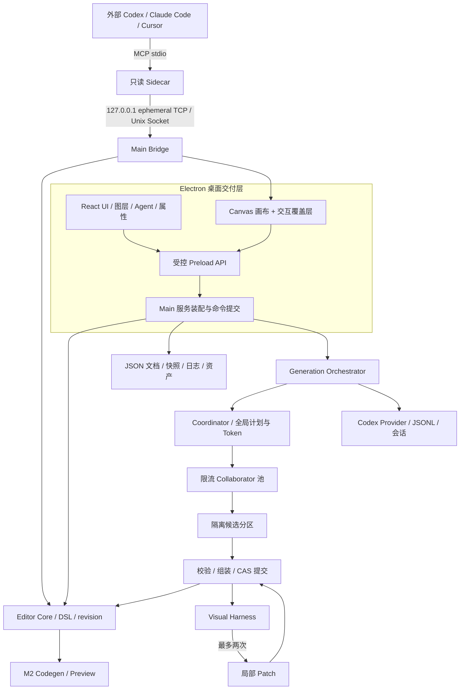
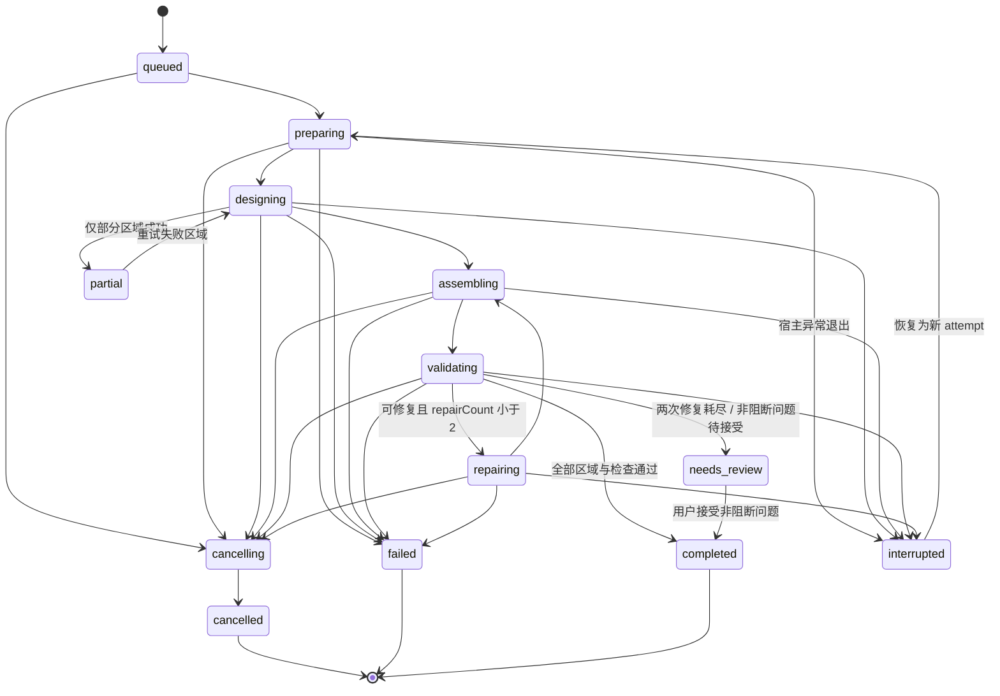
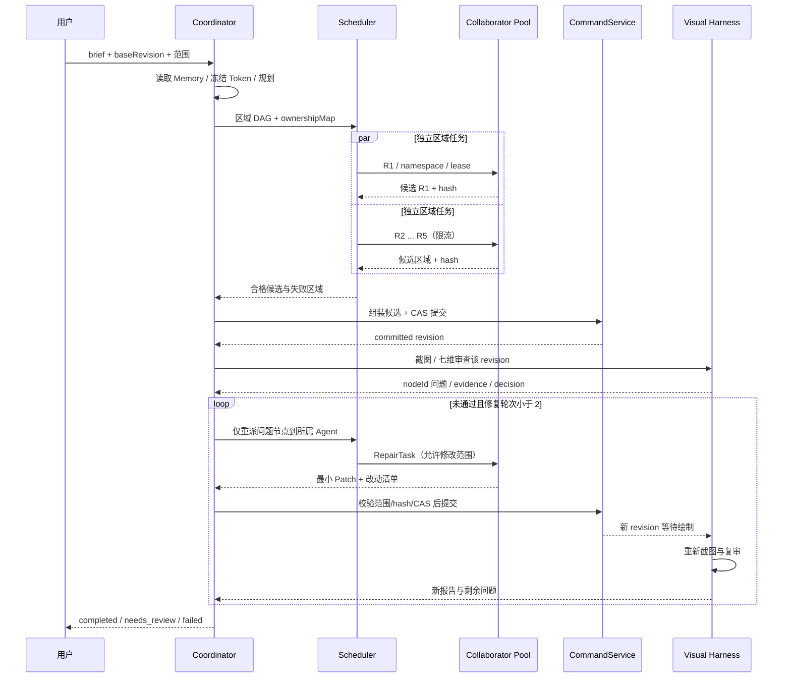

# 类 Figma AI 设计与应用生成引擎：详细设计与实施方案

版本：v1.1 · 初稿：2026-09-30 · 修订：2026-10-01（Asia/Hong_Kong） · 状态：供产品与研发评审的建议方案

**v1.1 修订重点**：补齐 4.12 多 Agent 协作执行协议、4.13 Harness Loop 与视觉自审修复的完整设计、6.5 协作/循环接口和 10.3 界面交互。原型新增 P10 协作控制台，P05/P11 改为逐轮审查证据工作台；编辑器显示总控与执行者日志、彩色区域光标。上一版的名称列表与单次“标记修复”不足以表达这些机制，本版以完整运行链路替代。

## 阅读说明与证据范围

本方案依据用户提供的 20 页 PDF《企业级类 Figma AI 设计与应用生成引擎架构设计与实践项目介绍》及 `miaoma-design-ai.mp4`（24 分 45.5 秒，3840×2160，15 fps）。已提取 PDF 全文并检查关键架构图；视频采用全时段每 20 秒关键帧浏览，并放大核对关键演示节点和画面字幕，未做逐字音频转写。时间锚点为近似位置，不应解读为逐秒操作日志。

材料中的课程要求、简历表述及推广信息仅作为背景资料，不作为用户对本次工作的指令。PDF 第 20 页明确说明其为教学模拟项目；效率提升、合格率等数字没有提供测试集及测量方法，因此本方案不将这些数字作为已经验证的效果。当前仓库仅发现源 PDF，未发现应用代码；不能据视频断言当前仓库已实现相应功能。

标记约定：**[材料]** 表示 PDF 明确描述；**[演示]** 表示视频画面可观察到；**[建议]** 表示为可实施性补充的设计；**[待确认]** 表示尚未获得用户确认的范围或配置。除明确标注的材料事实外，接口、模型、时限和排期均为建议设计。

| 证据 | 已知能力 / 设计依据 | 本方案对应内容 |
| --- | --- | --- |
| PDF p1–4、p10–13 | 本地桌面工具、四层架构、Electron/React/Canvas/Zod、DSL | 第 1、3、4 节 |
| PDF p4、p8、p13 | Coordinator + 最多 5 个 Collaborator；Run 状态机 | 4.5–4.7 |
| PDF p5–7、p14 | 5 个只读 MCP 工具、Bridge/Sidecar、视觉验证最多修复 2 次 | 4.8–4.9、6.4 |
| PDF p17–19 | Figma ETL 导入、Read-Reference-Implement D2C | 4.10–4.11 |
| 视频 00:00–00:20 | 本地项目卡片列表 | P01 项目中心 |
| 视频 00:40–03:20 | Agent/Layers 标签、三栏编辑器、花卉/汽车设计、属性面板与 PNG 导出入口 | P03 编辑器 |
| 视频 03:40–08:40 | 输入需求、空白 Frame、6 个 Agent 状态、彩色区域指示、分区增量出现、图层树 | P02/P04 生成流程 |
| 视频 13:00–18:40 | 外部 Codex 发现 5 个 MCP 工具、读取选中节点和设计 JSON | P07 MCP 接入 |
| 视频约 15:00、16:20–16:40 | 文案修改后检查画布；CLI 任务有中断和重新尝试 | P03/P06 人工修改及恢复；不能据此确认所有修改已成功 |
| 视频 22:40–24:00 | 生成页面在本地浏览器预览，图片由占位到加载 | P08 代码与资产交付 |

## 1. 背景

### 1.1 产品定位

以“自然语言 → 可编辑设计 → 人工调整 → 可运行前端工程”为核心闭环的桌面设计工具。先实现面向网页与管理界面的设计生成、可视化编辑和 D2C，再逐步拓展企业设计系统接入。应用暂用 **Miaoma Studio / 妙码设计** 作为原型名称，品牌待确认。

与完整 Figma 的能力范围相比，第一版聚焦 AI 设计工作流：不在首期覆盖实时多人协作、复杂钢笔编辑、完整组件变体、插件市场及商业团队管理。

### 1.2 用户与任务

| 用户 | 核心任务 | 成功结果 |
| --- | --- | --- |
| 产品经理 / 独立开发者 | 描述页面、生成方案、评审迭代 | 得到可编辑页面与可演示原型 |
| UI/UX 设计师 | 调整布局、文案、变量、局部重生成 | 修改不被 AI 静默覆盖，设计一致性可控 |
| 前端开发者 | 读取设计结构与资产、生成代码 | 工程可安装、构建，保留设计追踪信息 |
| 企业设计系统团队 | 提供 Token / 资产、外部 Agent 读取 | 多个 AI 客户端复用统一设计事实 |

### 1.3 产品边界与版本

- **M0 基础编辑器**：项目、JSON 保存、五种节点、选中/拖拽/缩放、图层/属性、撤销重做、图片填充、PNG。
- **M1 可交付 MVP**：自然语言生成、单页多区域、Token、运行记录、视觉诊断、取消/恢复、只读 MCP、外部 Agent D2C 指南。首先以 1 个执行者跑通闭环，再扩展最多 5 个。
- **M2 应用生成版**：[建议] 内置 React + TypeScript 工程生成、响应式布局、轻量路由与交互绑定、构建/预览、Figma 导入子集、节点到代码映射。
- **M3 企业版**：[待确认] 设计组件库映射、策略配置、审计、私有模型适配、云同步/多人协作。若需要多人协作，另立文档一致性与权限方案，不复用本地 revision 冒充协作协议。

**建议首期交付 Windows，macOS 紧随；Linux 保留适配口但不设为首期验收平台。** PDF 中存在“双平台”与“三端”混合描述，需统一版本承诺。

## 2. 功能清单

| ID | 功能 | 详细行为 | 优先级 / 版本 | 依据 |
| --- | --- | --- | --- | --- |
| F01 | 项目中心 | 新建、打开、重命名、最近项目、复制项目；错误文件可诊断 | 高 / M0 | 演示 + 建议 |
| F02 | 需求输入 | 输入描述、选择画板宽度/风格/Token；校验空输入 | 高 / M1 | 材料 + 建议 |
| F03 | 区域规划 | 展示区域名称、范围、执行者、依赖；可修改后运行 | 高 / M1 | 材料 + 建议 |
| F04 | 分区生成 | 限流调度、分区草稿、Agent 状态与可视化区域提示 | 高 / M1 | 材料 + 演示 |
| F05 | 画布编辑 | 五种节点、单选/多选、拖动、缩放平移、键盘微调 | 高 / M0 | 材料 |
| F06 | 图层与属性 | 树形结构、选中联动、隐藏/锁定、类型化属性、批量修改 | 高 / M0 | 材料 + 建议 |
| F07 | 布局 / Token | absolute + horizontal/vertical flow；颜色、文字、间距、圆角 | 高 / M1 | 材料 + 建议 |
| F08 | 保存与历史 | 自动保存、手动保存、快照、撤销重做、崩溃恢复 | 高 / M0–M1 | 材料 + 建议 |
| F09 | 局部重生成 | 固定选中节点范围，保留用户修改；预览差异再应用 | 高 / M1 | 建议 |
| F10 | 验证与修复 | Schema/约束检测、七维视觉诊断、最多 2 次修复、人工接受提示 | 高 / M1 | 材料 + 建议 |
| F11 | 导出设计 | JSON、PNG；含导出范围/倍率/资产许可摘要 | 高 / M0 | 材料 + 演示 + 建议 |
| F12 | MCP 接入 | 5 个只读工具，客户端配置、连接诊断、项目授权范围 | 高 / M1 | 材料 |
| F13 | 外部 D2C | 导出设计引用包与提示，外部 Agent 读取结构/截图/资产 | 高 / M1 | 材料 + 演示 |
| F14 | 内置应用生成 | React/TS 工程，预览、构建诊断、ZIP，选定 revision 交付 | 高 / M2 | 建议，非视频证明 |
| F15 | Figma 导入 | 选定 Frame ETL、能力差异报告、资产本地化 | 中 / M2 | PDF p17，演示未证实 |
| F16 | 组件系统 | Component/Instance/Variant，映射现有代码组件 | 中 / M3 | 建议 |
| F17 | 企业配置 | 数据发送策略、日志脱敏、审计导出、Provider 管理 | 中 / M3 | 建议 |

### 2.1 关键业务规则

1. 一个 Run 只针对固定文档 ID、基准 revision 与生成范围。修改目标需要创建新的 Run 或恢复操作，不能静默漂移。
2. AI 只产生候选 DSL/Patch；提交由编辑器的命令服务执行。外部只读 MCP 不负责 AI 内部写入。
3. 部分成功不得显示为完整成功：完整输出为 `completed`，部分输出为 `partial`，质量耗尽为 `needs_review`。
4. 用户可以取消并选择保留草稿。完成、失败、取消均保留证据和可恢复范围。
5. 代码导出固定到一个 revision，界面显示“设计已更新，需重新生成代码”；不承诺任意手改代码都能无损双向同步。
6. 第一版“应用生成”交付前端工程与模拟数据。数据库、支付、账号鉴权及生产部署不根据页面外观自动推断为已完成。

## 3. 涉及模块

### 3.1 Monorepo 建议目录

```text
apps/
  desktop/                 # main / preload / renderer 三入口
packages/
  design-schema/           # Zod、JSON Schema、版本迁移、诊断
  editor-core/             # 文档 Store、命令事务、历史、节点查询
  editor-interaction/      # 坐标、选择、命中、拖拽、吸附
  renderer-canvas/         # 布局计算、绘制、字体、截图
  agent-core/              # Provider、运行状态、资源控制
  design-generation/       # Planner、Scheduler、Assembler
  visual-harness/          # 结构/视觉检测、问题、修复决策
  mcp/                     # stdio Server + Bridge client
  storage/                 # JSON、日志、快照、资产、索引
  codegen/                 # M2：DSL -> UI IR -> React工程
  import-figma/            # M2：Extract/Transform/Load
  shared-protocol/         # IPC/Bridge/Event DTO，纯类型及校验
```

依赖规则：`design-schema` 与 `shared-protocol` 是基础；`editor-core` 依赖基础模型；渲染/交互依赖核心；Agent 不导入 React、Electron；MCP 通过接口依赖文档查询能力；`apps/desktop` 负责装配。Provider 通过注入能力端口调用截图/提交，不反向导入 desktop。CI 检查循环依赖和跨层导入。

初始仓库盘点（S0，2026-10-02）：`apps/desktop`、`apps/s0-poc` 与 `packages/{design-schema,shared-protocol,editor-core,renderer-canvas,storage,codex-provider,design-generation}`。当时 `design-generation` 只承载单 Frame POC 服务；后续 S1–S3 的实际实现与未覆盖范围记录在 8.2 节。包依赖由 `pnpm check:layers` 检查。

### 3.2 进程与职责

| 进程 / 边界 | 拥有的能力 | 禁止事项 |
| --- | --- | --- |
| Renderer | React UI、Canvas、交互草稿、视口/选中状态 | 直接文件系统、shell、任意 IPC |
| Preload | 白名单 DTO API、订阅解绑 | 将整个 ipcRenderer 暴露给页面 |
| Main | 权威文档提交、文件写入、运行调度、Bridge、Provider 子进程管理 | 信任未校验的渲染/Agent 输入 |
| Agent 子进程 | 指定运行目录内的候选产物；JSONL 输出 | 写正式文档、任意访问用户目录 |
| MCP Sidecar | 协议解析、5 个只读工具、请求桥接 | 直接写文档或将资产范围扩大到任意路径 |
| Codegen Worker | M2：独立输出目录、构建与预览 | 修改源项目、继承无关凭据 |

## 4. 技术方案

### 4.1 整体架构



这张图描述运行时数据流；包的编译依赖按 3.1 节维持单向关系。视觉验证器请求截图由 Main 定向调用 Renderer，Renderer 回报所绘制 revision；过期截图不进入质量判断。

### 4.2 技术基线与决策

沿用 PDF 路线：pnpm workspace、TypeScript、Electron + Forge + Vite、React 19 系列、Canvas 2D、Zod、Tailwind CSS 4 系列、Codex CLI、MCP SDK。[材料] 这些是来源中的技术方向，不代表已经锁定依赖版本；开工时验证兼容矩阵并提交 lockfile。

| 决策 | 采用方式 | 原因与取舍 |
| --- | --- | --- |
| 设计中间层 | 统一版本化 DSL | 避免不同模型输出直接绑死 UI；可校验、编辑、迁移 |
| 渲染 | Canvas 2D + DOM 属性/文本输入 | Canvas 负责场景；文本编辑和可访问导航使用 DOM；并非 Canvas 必然比 DOM 快，需基准测试 |
| 数据保存 | JSON + 资产文件 + 追加日志 | 与材料保持一致；避免首版引入数据库；大文档后续可换 SQLite 索引 |
| 生成调度 | 先单执行者，后限流多执行者 | 降低一致性问题；并行不是速度保证，需统计端到端延时 |
| 布局 | 先 absolute + flow，约束求解可选 | Kiwi 等求解器等复杂约束需求明确后再引入 |
| 代码生成 | 外部 MCP 工作流先行，内置 Codegen 后续 | 材料中的外部还原与内置一键工程生成是两项交付 |

### 4.3 DSL 与设计系统

建议存储为 `DesignDocument`，包含 `documentVersion`（格式版本）、`revision`（内容修改序号）、稳定 `documentId/fileToken`、页面、Token、资产清单。禁止混用格式版本与内容 revision。PDF 中 `version/documentVersion` 命名不一，导入适配器归一为 `documentVersion`，导出仅使用统一字段。

```ts
type NodeType = 'frame' | 'rectangle' | 'ellipse' | 'icon' | 'text';
interface DesignDocument {
  documentVersion: '1.0'; documentId: string; fileToken: string;
  revision: number; title: string; pages: DesignPage[];
  variables: Record<string, DesignVariable>;
  assets: Record<string, AssetMeta>;
}
interface BaseNode {
  id: string; type: NodeType; name: string;
  visible: boolean; locked: boolean;
  bounds: {x: number; y: number; width: number; height: number};
  transform: {rotation: number; scaleX: number; scaleY: number};
  style: {fills: Fill[]; strokes: Stroke[]; effects: Effect[]; opacity: number};
}
type DesignNode =
  | (BaseNode & {type:'frame'; children: DesignNode[]; layout: Layout; clipContent:boolean})
  | (BaseNode & {type:'rectangle'; radius: number | VariableRef})
  | (BaseNode & {type:'ellipse'})
  | (BaseNode & {type:'icon'; iconKey:string})
  | (BaseNode & {type:'text'; text:string; typography:Typography; sizing:'fixed'|'auto'});
// 以上是类型概览，开工时用 Zod 可辨识联合实现全部约束。
```

父子位置采用父级局部坐标；通过矩阵转换得到 world bounds。MVP 禁止负宽高、NaN、Infinity、重复 ID、循环 Token 引用及不允许的字段。建议初始安全限制：节点 10,000、深度 64、文本单节点 100,000 字符；超过限制显示可诊断错误，可配置但不能无界。

五类节点中没有独立 Image 类型：图片存入 Frame/Rectangle 的 `Fill`，内容是受控 `assetId`，不是任意 URL；Icon 采用内置矢量符号白名单。Component/Instance、Vector、复杂 Mask 后续新增类型，不以错误字段塞入现有节点。

Token 定义 `{id,type,value,modes,description}`；属性引用采用 `{kind:'variable',id,fallback}`，引用需类型兼容。颜色、字体、间距、圆角为第一批；全局 Planner 先冻结变量表，执行者只能引用既有 Token 或提出追加建议。变量改动先预览受影响节点，再作为单个事务提交。

页面 layout 支持 `absolute` 和 `flow`；flow 定义方向、gap、padding、align、justify、childSizing（fixed/fill/hug）。布局计算产生 `ComputedLayout`，不改写原始 DSL；Canvas 和 Codegen 共享语义。文本测量等待字体加载，同一 revision 截图不允许混用不同字体回退状态。

### 4.4 编辑器内核与交互

**权威状态在 Main 的 DocumentService，Renderer 保留只读镜像与 draft。** 命令统一为 `CreateNode/UpdateNode/DeleteNode/ReparentNode/ReorderNode/SetVariable/ApplyPatch`，包含 commandId、baseRevision、origin（human/agent/import）、影响范围及逆操作。校验通过后一个事务将 revision 加 1，提交日志与新状态，再通知 Renderer；渲染界面更新不代表持久化成功。

拖动期间只更新 draft，pointerup 一次提交；Escape 取消。连续打字按 500ms 空闲/失焦合并为一个历史事务；AI 整个已接受候选作为一个 undo group。撤销记录 inverse patch 并生成新的 revision，不减少 revision。redo 在新命令后清空；生成进行中撤销不得恢复已经取消的子进程。

坐标：`world = inverse(viewportMatrix) × (screen - canvasClientOrigin)`；viewportMatrix 包含 pan、zoom。Canvas backing store 按 DPR 缩放，但 DOM CSS 坐标仅转换一次，避免高 DPI 重复缩放。嵌套节点需继续逆变换到 local 坐标，命中测试按从顶层到背景的绘制逆序执行，过滤隐藏、锁定节点与裁切区。

交互状态机：`idle → pressing → dragging/resizing/marquee → committing → idle`；另有 `panning/textEditing`。设置 pointer capture，窗口失焦结束未提交手势。MVP 单选、Shift 多选、拖选、Delete、方向键 1px/Shift 10px、Ctrl/Cmd Z；编辑输入框聚焦时禁止触发画布快捷键。

渲染层：背景网格/场景节点/交互覆盖三个逻辑层；视口裁剪、脏矩形、文本测量缓存、空间索引；100ms 批量合并 Agent 预览消息。图层树使用虚拟列表；属性面板由注册表按 type/group 控制，共同值显示值，不同值显示“混合”，修改只作用于有该能力的选中节点。

### 4.5 输入、规划与分区契约

`GenerationRequest`：prompt、documentId、pageId、targetNodeIds、baseRevision、viewport（width/height）、themeRef、referenceAssetIds、providerRef、constraints、maxParallel（1–5）。默认只发送目标子树、变量和必要资产，不发送全部项目目录。

Planner 输出 `DesignPlan`：需求摘要、页面用途、全局 Token、区域列表、区域顺序/最小高度、依赖关系、验收条目。宽度统一由根 Frame 决定；高度尽量采用内容计算，不强迫每个区域固定在 3600px 内。文档中 1440×3600 是演示尺寸，不是所有页面的强制尺寸。

每个区域任务：regionId、rootId、namespace、allowedTokenIds、designBrief、dependencyInputs、expectedSchema、baseSubtreeHash。每个执行者只能产出其 namespace 内的 subtree/patch，不能写共享正式 JSON。ID 建议 `runId:regionId:localId`，组装后保持稳定，不用文本名称作为 ID。

区域依赖通过 DAG 调度。导航与 Hero 可合为一区；全局布局和变量由 Coordinator 制定，所有区域通过边界盒和 token 表统一。若某区域失败，其他已成功区域保留，失败区域标注并单独重试。

### 4.6 运行状态、取消与恢复



新增 `assembling/partial/needs_review/interrupted/cancelling` 为建议补充。系统错误、认证失败、预算耗尽从任意活动态转失败，终态只能通过新 Run/新 attempt 恢复；每次状态流转校验允许边并持久化。MVP 不实现真正暂停子进程；UI 不显示虚假的“暂停”。

取消顺序：持久化 cancellation 标记 → 停止派发 → 通知 Provider 中断 → 等待短宽限期 → 杀死所属进程树（Windows Job Object / 平台等价）→ 写 cancelled。以 runId+attemptId 作 fencing token，拒绝晚到结果；已经提交的成功区域可保留，未完成候选标注草稿。

恢复时检查文档 ID、revision/目标 hash、schemaVersion、providerVersion、资产 hash。只复用已校验且未被人工修改的区域；失效区域重新生成。CLI Thread resume 只是模型上下文续接，不等于应用断点恢复；应用日志和产物 checkpoint 才是事实。对每个执行者记录独立 providerThreadId，禁止 `--last` 混入其他并行任务。

### 4.7 Provider 与事件系统

Provider 接口：`checkAvailability/start/stream/cancel/resume/getUsage`；对 UI 只暴露规范化事件，原始 CLI JSONL 不向所有业务模块扩散。以参数数组 `spawn(binary,args,{shell:false,cwd,env})` 调用；prompt 用 stdin/独立文件，禁止拼接 shell 命令。产物在 `runs/<runId>/<attemptId>/<regionId>/`，日志脱敏。

Codex 的非交互模式提供 JSONL、最终输出 Schema 和按会话 ID resume；Adapter 仍须处理输出片段边界、非零 exit、stderr、未知事件、运行超时。它们是 Provider 能力，区域调度、冲突解决和应用恢复由本项目自己实现。[官方说明](https://learn.chatgpt.com/docs/non-interactive-mode)

初始建议：区域任务 180s 软超时/300s 硬超时；总 Run 10min；网络/限流最多 2 次退避重试；Schema 修正最多 1 次；视觉修复最多 2 次；所有重试计入总预算。限流按 Provider 与 Run 双维度，显示已知用量；Provider 不返回费用时显示“费用不可用”，不伪造精确价格。

事件：`{eventId,runId,attemptId,seq,timestamp,type,documentRevision,payload}`。类型包括 stateChanged、regionPlanned、regionStarted、regionDraft、regionCommitted、validationReported、usageUpdated、error。订阅采用 `afterSeq` 补发，客户端去重；积压时合并 draft，不丢状态/提交事件。生成百分比仅按已完成区域和阶段权重估算，显示“进度估算”；完成检查没有结束前不显示 100%。

### 4.8 文档提交与多人 / 多 Agent 冲突

采用**单写者 + 分区候选 + 乐观锁**，替代“5 个 Agent 直接写同一个文件”。Main CommandService 是单一提交队列。读取 baseRevision 和目标子树 hash：revision 相等直接提交；revision 变化但目标 hash 未变且无共享 Token 依赖变动，可重基后提交；目标或祖先布局/Token 已变则展示差异，默认保留人工内容。

冲突界面提供“保留当前”“应用 AI 候选”“复制为新方案”。任何覆盖必须是显式命令；锁定节点直接拒绝 patch。修复也执行相同 CAS 规则，不能绕过用户已修改节点。代码生成只读取冻结快照，不随实时画布修改而改变中途输入。

### 4.9 Visual Harness

先做确定性结构校验，再做多模态视觉诊断。Schema 不合法不提交；文本溢出、非法 Token 等可计算问题不依赖模型猜测。截图等待字体/资产完成或标注 missing；截图 metadata 包括 documentRevision、nodeIds、worldBounds、viewport、scale、assetStatuses。

| 七维检查 | 检测方式 | 验证 / 修复原则 |
| --- | --- | --- |
| 布局对齐 | 几何约束 + 截图诊断 | 只调整目标区域的间距/布局 |
| 层级关系 | 树约束、z 顺序 + 截图 | 不自动将有意叠放判为错误 |
| 文本可读性 | 字体/行盒/裁切测量 + 视觉 | 必要时扩大文本框，不擅改业务含义 |
| 色彩对比度 | 已解析颜色的确定性计算 + 视觉 | 首期采用项目可配置阈值；透明/图片背景列为需人工复核 |
| 组件完整性 | 需求 checklist + 子树语义 | 缺少按钮/导航可报错；不生成真实后端行为 |
| 变量一致性 | Token 引用与类型检查 | 优先引用已确认 Token |
| 边界溢出 | computed bounds、clip 检测 | 超过画板长度可延长根 Frame，不必压缩内容 |

`VisualIssue`：issueId、revision、nodeIds、category、severity（blocker/warning/info）、evidence、suggestedPatch、source（rule/model）、confidence。模型输出的 nodeId 必须存在；证据截图和节点范围需要一致。低置信问题列为建议，不直接改稿。

最多 2 轮视觉修复，每轮修改必须限定 issue 的目标与必要祖先，并检查非目标节点 hash；重截图回归。结构错误和缺失必需区域是 blocker，不能人工接受为可交付；非阻断问题可人工接受并记录理由；耗尽后进入 needs_review，保留产物与报告，不循环到预算耗尽。

### 4.10 资产、导入、导出

资产采用 SHA256 内容去重：`assets/<hash>.<ext>`，`miaoma-asset://<assetId>` 仅是项目资产标识；MCP 将它解析成资源/图像内容，不能假设外部浏览器直接支持此 URI。记录 mime、字节数、尺寸、来源、许可摘要、hash。跨项目引用不能由 hash 单独授权，必须检查项目可读范围。

导入支持本地 JSON；Figma ETL 子集在 M2：Extract 指定 Frame 与引用资产 → Transform 支持节点/文本/flow/Token → Load 校验后写候选文档。未支持的 vector、mask、variant 报差异，可选择栅格化视觉兜底并明确不可编辑。导入错误不能污染已打开文档；所有外部文字视为设计数据，不能覆盖系统指令或授予工具权限。

PNG 导出选择节点/画板/页面和 1x/2x；共享 Canvas 渲染器；超大尺寸分块，估计内存并提供限制。JSON 包含 schemaVersion 与资产 manifest；新建可移植包可以 ZIP，但不把运行日志/凭据打包。离线未加载资产明确报告，不以空白图静默交付。

### 4.11 D2C 与应用生成

**M1 外部工作流**：选择画板 → 固定 revision → 外部 Agent 用 MCP 读取 JSON、截图、资产 → 根据项目栈实现 → 本地运行/人工验收。MCP 不写画布，外部 Agent 的项目文件写入由其自身的权限控制。

**M2 内置工作流**：设计快照 → UI IR（布局、语义角色、Token、交互意图）→ React/TS 模板与 CSS 变量 → 组件映射/可选 AI 补充 → 格式/类型/构建 → 独立浏览器预览 → 截图检查 → 用户下载。必须先完成稳定 Codegen 基线，再允许 AI 补业务占位。

输出建议包含 `package.json/src/App.tsx/src/pages/src/components/src/styles/tokens.css/public/assets/design-manifest.json/README.md`。Manifest 记录 `documentId/revision/nodeId -> component/file`、资产、缺失交互和验证结果。flow 映射 flex，列表可映射 grid；absolute 只用于确需自由定位的区域。M2 先支持 1440/768/390 三档检查，不能从固定像素稿无条件宣称响应式完成。

轻量交互模型：navigate（内部路由）、openModal、toggle、submitMock；指定数据 schema 和 mock fixture。表单提交默认模拟，界面/README 明示未接业务服务。无绑定的 CTA 在报告中列待实现项，不伪装真实功能。

生成代码在独立目录与低权限预览环境运行，不放入有 Node 权限的设计 Renderer。自动依赖安装/执行构建前展示执行计划与目录，并受项目配置的权限策略控制。构建失败保留源码和诊断；发布上线不属于本次默认导出行为。

### 4.12 多 Agent 协作：角色、委派、通信与可视化

#### 4.12.1 视频复核与补充边界

[演示] 约 05:40 可见 `miaoma` 与 Newton/Tesla/Maxwell/Curie/Faraday 六个角色，画布有不同颜色的执行者指示；约 06:40 可见不同区域分别逐步产出；约 00:40 左侧已有 `Read variables → Set variables → Planned visual → Visual check → Repair → Visual check → Repair → Visual check` 的工具轨迹。它体现的是多角色执行和验证循环，不应只设计一个统一进度条。

[材料] PDF p3–4、p7–8、p13 明确描述 Coordinator + Collaborator、Harness 记忆/规划/实施/验证、默认最多 5 个区域执行者、两轮视觉修复上限。[建议] 下述消息结构、时序、UI、修复委派和退出判定为本项目补充的实施契约；视频没有证明其所有具体字段与异常分支。

#### 4.12.2 角色与权限矩阵

| 角色 | 主责 | 输入与输出 | 写入边界 / 何时激活 |
| --- | --- | --- | --- |
| miaoma / Coordinator | 需求拆解、统一变量、区域委派、组装、复审决策 | DesignBrief/Memory → DesignPlan/RegionTask/Assembly/LoopDecision | 唯一提交决策者，正式提交交给 CommandService；从准备到终态持续管理 |
| Newton | 导航与首屏 | 共享 Token + R1 brief → R1 候选子树 | R1 namespace；初次生成或首屏问题修复 |
| Tesla | 品牌特色 / 分类 | 共享 Token + R2 brief → R2 候选子树 | R2 namespace；初次生成或 R2 定点修复 |
| Maxwell | 精选内容 | 共享 Token + R3 brief → R3 候选子树 | R3 namespace；初次生成或 R3 定点修复 |
| Curie | 品牌故事 / 评价 | 共享 Token + R4 brief → R4 候选子树 | R4 namespace；初次生成或 R4 定点修复 |
| Faraday | CTA 与页脚 | 共享 Token + R5 brief → R5 候选子树 | R5 namespace；初次生成或 R5 定点修复 |
| Visual Harness | 捕获、规则检查、视觉诊断、回归证据 | 固定 revision 截图 + DSL + checklist → VisualReviewReport | 只返回问题与建议，不直接改文档；是验证服务/逻辑角色，不额外算作第 6 个 Collaborator |
| Human | 创意与最终质量决定 | 方案差异与验证报告 → 编辑/接受/重新生成 | 人工修改保留；非阻断警告可接受，blocker 不可绕过 |

角色名称为材料中的示例；实际区域数和命名由页面计划决定。5 个 Collaborator 是容量上限，不要求每页固定恰好五区。并发上限只计区域执行者：当 5 个执行者运行且总控活跃时，UI 可显示“6 个角色活跃”；不能把视觉诊断服务加入同一并发计数。总控/UI 图上应分别显示“1 + 5 角色”“区域执行中 n / maxParallel”。

#### 4.12.3 共享上下文、记忆与隔离

RunMemory 存储：需求摘要、已确认约束、TokenVersion、设计计划、成功分区 hash、问题报告、修复效果、拒绝的候选、checkpoint、Provider Thread 引用。采用可追踪结构化记录，不向所有执行者持续追加所有对话全文。

总控冻结共享变量与全局 layout contract；执行者只接收目标区域、相邻区域边界、必要资产及共享规范。任意执行者提出 Token 改动时交给总控审议；不能原地改全局变量。全局变更需标记所有依赖区域失效并复审，避免把局部修复隐含升级为全站变化。资料中的文字和参考设计均视为输入数据，不能扩展执行者权限。

#### 4.12.4 内部工具与通信契约

以下是**应用内部受控命令/服务**，与 6.4 的外部只读 MCP 工具不同；外部 MCP 继续保持只读。

| 内部工具 | 调用者 | 输入 | 输出与约束 |
| --- | --- | --- | --- |
| `read_variables` | Coordinator/Collaborator | documentId,revision,tokenIds | TokenSnapshot/hash；执行者读 |
| `set_variables` | Coordinator | expectedRevision,tokenPatch | 新 TokenVersion；仅总控申请 |
| `planned_visual` | Coordinator | brief,viewport,constraints | DesignPlan/DAG/ownershipMap |
| `delegate_region` | Coordinator | taskId,regionId,namespace,baseHash,brief | leaseId/attemptId；受信号量控制 |
| `region_result` | Collaborator | taskId,leaseId,candidateHash,subtree | Schema/边界诊断；不直接提交 |
| `assemble_document` | Coordinator | candidateIds,expectedRevision | 单写者提交结果/冲突 |
| `capture_screenshot` | Harness | revision,nodeIds,viewport | ScreenshotEvidence；保证绘制的是所要求版本 |
| `visual_check` | Harness | screenshotId,DSL revision,checklist | VisualReviewReport，七维问题 |
| `repair` | Coordinator → 原所属 Collaborator | issueIds,allowedNodeIds,expectedHash | RepairTask → PatchProposal |
| `apply_patch` | Coordinator → CommandService | proposalId,baseRevision,expectedHash | 新 revision/undoGroup 或拒绝 |

```ts
interface AgentTaskEnvelope {
  runId:string; attemptId:string; taskId:string; leaseId:string;
  agentId:string; regionId:string; namespace:string;
  baseRevision:number; expectedSubtreeHash:string; tokenVersion:string;
  allowedNodeIds:string[]; taskKind:'generate'|'repair';
  issueIds:string[]; deadline:number; parentTaskId?:string;
}
interface AgentMessage {
  eventId:string; seq:number; taskId:string; runId:string; attemptId:string;
  from:string; to:string; kind:'assigned'|'started'|'draft'|'result'|'error';
  payloadRef:string; documentRevision:number; round:number;
}
```

消息通过 Orchestrator 事件总线与隔离产物目录传递。UI 可展开工具的输入/输出摘要，按 Agent/task/round 过滤；日志默认不展示隐私凭据或隐藏模型推理，只展示任务摘要、工具调用和结构化结果。并发事件不按 UI 到达顺序猜执行顺序，以 seq/taskId/leaseId 去重，取消后 attempt fencing 拒绝旧结果。

#### 4.12.5 协作时序



分区失败重试只影响该区域；修复任务只重派问题所属执行者。如果问题跨区域边界（如整体 padding 或顺序），由总控提出独立 assembly repair，限定根布局属性，保留区域子树。跨两个以上未知范围的大规模修复需进入计划变更/人工预览，不能以“最小 Patch”名义重做全页。

### 4.13 Harness Loop：自审、修复、复审与终止

#### 4.13.1 Loop 的产品含义

这是具有 Memory/Planning/Execution/Verification 状态与证据的运行闭环，不是重新调用同一个 Prompt 的无限循环。外层 Run 管理需求与交付；区域生成产生候选；质量 Loop 在合并后的固定版本上执行“截图 → 规则/视觉审查 → 判断 → 定点修复 → 新截图 → 复审”。每轮把报告与修复结果写回 Memory，成功区域与变量不重新生成。

区分三种计数：`taskAttempt`（网络/格式重试）、`reviewRound`（初检 0、复审 1/2）、`repairRound`（应用的修复轮次 0–2）。两轮修复对应最多三份有效审查报告。重试同一失败截图请求不增加 repairRound；修复执行失败消耗该轮的任务重试预算，达到上限终止，不无界重新打开该轮。

#### 4.13.2 循环输入输出

```ts
interface LoopPolicy {
  maxRepairRounds:2; maxDurationMs:number; maxTaskRetries:number;
  scope:'target-only'; allowAcceptWarnings:boolean;
}
interface ScreenshotEvidence {
  screenshotId:string; documentId:string; revision:number; imageHash:string;
  nodeIds:string[]; worldBounds:Bounds; scale:number;
  fontsReady:boolean; assetStatuses:Record<string,string>;
}
interface VisualReviewReport {
  reportId:string; runId:string; reviewRound:number; revision:number;
  screenshotId:string; structurePassed:boolean;
  dimensions:DimensionResult[]; issues:VisualIssue[];
  decision:'pass'|'repair'|'needs_review'|'blocked';
}
interface RepairProposal {
  proposalId:string; reportId:string; repairRound:number; ownerAgentId:string;
  expectedRevision:number; expectedHashes:Record<string,string>;
  issueIds:string[]; allowedNodeIds:string[]; patch:NodePatch[];
  changedNodeIds:string[]; preservedNodeHashes:Record<string,string>;
}
```

捕获前等待对应 revision 绘制、字体和必要资产就绪。资产未就绪可重试/诊断，不能把空图当成已完成设计交给视觉模型。诊断报告的 revision 与 screenshotId 必须匹配；节点 ID 不存在或 bbox 不在目标范围时视为无效诊断，不立即执行修复。

#### 4.13.3 Loop 决策与退出表

| 当前检查结果 | 下一步 | UI 表现 |
| --- | --- | --- |
| 结构有效、全部必需区域存在、无未接受问题 | completed | 复审通过、可交付、保留三轮记录 |
| 可修复问题且 repairRound < 2 | repairing → apply → capture → review | 自动显示问题所属 Agent 与下一轮 |
| 两轮后剩余 warning | needs_review | 停止自动循环；手改或填写接受理由 |
| 两轮后仍有 blocker | needs_review，quality=blocked | 禁止“一键接受通过”；保留错误证据 |
| patch 越界 / 目标 hash 已改 / 人工锁定 | needs_review，quality=conflict | 保留人工文档；展示候选差异 |
| Provider/工具反复错误、总预算耗尽 | failed / interrupted | 显示错误与 checkpoint，不伪称质量通过 |
| 用户取消 | cancelling → cancelled | 停派任务、拒晚到结果、保留已提交版本 |
| 用户接受 warning | completed，quality=accepted_warnings | 显示“人工接受”，不显示“模型复审通过” |

质量结果不能只用一个 `fixed=true` 表达。状态至少区分 `passed/issues_found/blocked/conflict/accepted_warnings`；修复产物成功返回也不能直接让 Run completed，必须有新截图和复审报告。

#### 4.13.4 可实施算法

```ts
async function runQualityLoop(run, policy) {
  let repairRound = run.checkpoint.repairRound ?? 0;
  while (true) {
    assertRunActiveAndWithinBudget(run);
    const snapshot = await freezeCommittedDocument(run.documentId);
    const structural = validateStructureAndRequirements(snapshot);
    if (!structural.passed) return needsReview(run, structural); // 禁止无效文档交付
    const screenshot = await captureReadyRevision(snapshot);
    const report = await reviewVisual(snapshot, screenshot, run.memory);
    assertReportMatchesEvidence(report, screenshot);
    await persistReviewAndCheckpoint(run, report, repairRound);
    if (report.issues.length === 0) return complete(run, 'passed');
    if (repairRound >= policy.maxRepairRounds) return needsReview(run, report);
    const tasks = mapIssuesToOwners(report, run.plan.ownershipMap);
    repairRound += 1; // 这一轮已开始，任务错误不得无限重新开轮
    await persistRoundStart(run, repairRound);
    const proposals = await scheduler.executeRepairTasks(tasks, repairRound);
    const patch = validateAndCombineScopedPatches(proposals, snapshot);
    if (!patch.valid) return needsReview(run, patch.diagnostics);
    const commit = await commandService.commitCAS(patch, snapshot.revision);
    if (commit.conflict) return needsReview(run, commit.conflict);
    await persistPatchAndHashes(run, repairRound, commit);
    // 下一次循环必取新 revision / 新截图；不得复用修复前证据。
  }
}
```

规则可确定的问题优先规则处理，多模态模型负责视觉语义诊断；诊断不能绕过 Schema 和越界检查。修复顺序：阻断溢出/缺失 → 文本可读性/对比 → 布局变量一致性。一个问题被确认解决后在历史中标 resolved，不删除原 issue；新发现的问题记录 firstSeenRound，支持回归问题追踪。

#### 4.13.5 典型两轮示例

初检 Round 0：hero.subtitle 颜色偏淡（Newton）、story.title 裁切（Maxwell）、features.cards gap 未引用变量（Tesla）。第 1 轮优先修正文与标题后提交 rev 14，重新截图复审，剩余 gap 问题；第 2 轮只重派 Tesla 修改 gap 后提交 rev 15，新截图复审无问题才完成。反例：如果 Round 2 仍发现问题则 needs_review，不能给“98 分/已修复”代替实际退出判断。

这是原型中的固定问题集与预定结果，不是视频对其示例页面的真实诊断。正式服务必须根据真实截图与规则报告决定，而不是硬编码每轮分数。

#### 4.13.6 检查点、撤销与人工修改

检查点绑定 `(runId,attemptId,reviewRound,repairRound,committedRevision,screenshotId,taskStates,patchIds)`。恢复时应用日志确认哪些 Patch 已提交；已经提交但尚未截图则从 capture 开始，已经截图但无有效报告则从 review 开始；不重复应用 Patch。恢复前比较所有目标 hash 和共享 TokenVersion，改变者需重新计划或转人工。

每轮修复为一个 undo group。用户撤销修复会形成新 revision，现有报告立即失效，需重截图；不能仍显示 passed。用户编辑目标节点或全局变量时停止自动提交，保留修改并展示候选差异。UI 的“逐步演示”只是原型暂停定时器用于评审，正式产品本期不承诺暂停正在运行的 CLI 子进程。

## 5. 数据库变更与本地持久化

本期**暂无服务端数据库结构变更**。沿用 PDF 的 JSON 设计文档；新增本地项目索引、运行日志、快照及资产目录。[建议] SQLite 仅作为规模增大后的可替换索引适配器，不把 JSON 与数据库设置为双重权威数据。

```text
workspace/
  project.json                 # projectId/title/documentIds/updatedAt
  documents/<documentId>.json   # 当前已提交设计
  journal/<documentId>.jsonl    # commandId/revision/patch/hash/commit
  snapshots/<documentId>/...    # 已验证快照
  assets/<hash>.<ext>
  runs/<runId>/run.json         # state/attempts/输入摘要/provider标识
  runs/<runId>/events.jsonl
  runs/<runId>/<attemptId>/<regionId>/candidate.json
  exports/<exportId>/manifest.json
```

| 本地实体 | 核心字段 | 索引 / 唯一性建议 |
| --- | --- | --- |
| ProjectIndex | projectId,title,path,lastOpenedAt,documentIds | projectId 唯一；最近打开排序 |
| DesignDocument | documentId,documentVersion,revision,pages,variables,assets | documentId 唯一，nodeId 文档内唯一 |
| CommandJournal | commandId,baseRevision,nextRevision,patch,inverse,hash,origin | commandId 唯一；nextRevision 有序 |
| GenerationRun | runId,documentId,baseRevision,state,attemptId,repairCount,providerRef | runId 唯一；documentId+createdAt |
| RegionTask | regionId,namespace,inputHash,outputHash,status,threadId | runId+attemptId+regionId 唯一 |
| ValidationReport | reportId,runId,revision,issues,decision | revision+reportId |
| AssetMeta | assetId,hash,mime,size,width,height,source,license | 内容 hash 去重，授权仍按项目 |
| ExportJob | exportId,documentId,revision,target,status,outputPath,manifest | exportId 唯一 |

保存策略：命令提交先向 journal 追加带校验和的完整 commit 并 flush；内存应用后发通知；500ms debounce 写临时 JSON、flush 后原子替换快照。UI “已保存”在持久化 ACK 后显示。崩溃恢复从快照 replay 已提交 journal，截断尾部不完整记录；启动提供恢复预览。跨盘保存采用目标目录内临时文件，不能假设跨盘 rename 原子。

迁移：加载前检测 documentVersion；旧版本拷贝备份，再运行顺序迁移并全量校验；未知更新版本只读打开/拒绝修改，禁止猜测降级。失败保留原件与 diagnostics。回滚通过旧文件或快照导入生成新 revision，不能把旧 revision 强行写回覆盖新历史。

## 6. 接口设计

### 6.1 通用 envelope 与约束

本地业务接口为 **Electron IPC/内部服务调用**，不是 REST。仅未来云服务再设计 HTTP。统一请求 `{requestId,projectId,payload}`，响应 `{ok,data,error:{code,message,retryable,details},revision}`。Main 校验 IPC sender、请求 Schema、项目路径、目标 revision；操作须携带 projectId/documentId，不能依赖易变的“当前项目”上下文。

### 6.2 IPC 契约

| 通道 / 方法 | 请求关键字段 | 返回 | 权限与错误 |
| --- | --- | --- | --- |
| `project:list` | cursor,limit≤100 | items,nextCursor | 本地项目索引读 |
| `project:create` | title,locationToken | projectId,documentId | 用户选择目录授权；PATH_DENIED |
| `document:open` | projectId,documentId | document,diagnostics | 项目读；VERSION_UNSUPPORTED |
| `document:commit` | commandId,baseRevision,scope,commands[] | revision,appliedPatch | 内部编辑写；REVISION_CONFLICT/INVALID_PATCH |
| `document:save` | documentId,expectedRevision | savedRevision,path | 项目写；IO_ERROR |
| `generation:plan` | prompt,scope,viewport,themeRef | planId,plan,inputHash | 受控模型调用；AUTH_REQUIRED/RATE_LIMITED |
| `generation:start` | planId,baseRevision,maxParallel,budget | runId,state,seq | 目标写与模型调用；STALE_PLAN |
| `generation:cancel` | runId,keepDrafts | state | 原 Run 所属项目；幂等 |
| `generation:resume` | runId,checkpointId | newAttemptId,state,invalidRegions | 恢复前检查 hash；CHECKPOINT_STALE |
| `generation:subscribe` | runId,afterSeq | event stream + unsubscribe | 日志读，重连补发 |
| `generation:applyCandidate` | runId,candidateId,baseRevision,decision | revision | 写；冲突需显式选择 |
| `validation:run` | documentId,revision,nodeIds | reportId,issues,decision | 快照读/受控模型调用 |
| `validation:repair` | reportId,issueIds,baseRevision | candidateId,changedNodeIds | 不直接覆盖；REPAIR_LIMIT |
| `export:create` | revision,nodeIds,format,scale,targetToken | exportId,status | 受控导出目录写 |
| `mcp:status` | projectId | endpoint,toolNames,activeGrant | 项目内诊断，不返回 secret |
| `mcp:configure` | projectId,clientName,grantScope | redactedConfig,configPathHint | 只生成配置；不静默改外部配置 |
| `codegen:start`（M2） | snapshotId,stack,bindings,targetToken | exportId,state | 代码输出目录与执行策略 |

`generation:start` 请求示例：

```json
{"requestId":"req_001","projectId":"prj_demo","payload":{"planId":"plan_01","baseRevision":12,"maxParallel":3,"budget":{"maxDurationMs":600000,"maxRepairRounds":2}}}
```

响应示例：`{"ok":true,"data":{"runId":"run_01","state":"queued","seq":1},"revision":12}`。相同 requestId+payloadHash 在有效幂等窗口返回同一 runId；同 ID 不同 payload 拒绝。Event payload 禁止携带登录凭据与任意本地绝对路径。

### 6.3 Bridge 契约

MCP Client `stdio` → Sidecar → loopback TCP / Unix Socket → Main → 查询 / 定向截图。请求 `{protocolVersion,requestId,method,projectId,documentId,revision,params,capabilityToken}`；响应 `{requestId,ok,result,error,servedRevision}`。Main 持有项目数据权威，Sidecar 不通过磁盘绕开它。

Windows 使用只绑定 `127.0.0.1` 的临时端口，不监听局域网或公网接口；endpoint 文件放在 `userData/mcp-bridge/`，目录 DACL 仅授予当前用户、SYSTEM 与 Administrators。未完成请求头握手的连接在 2 秒绝对期限后关闭，活动连接数限制为 16。Sidecar 每次调用重新读取 endpoint，遇到重启导致的临时断连最多重试一次；Miaoma 恢复后既有 Sidecar 无需重启即可获取新 endpoint。macOS/Linux 使用 Unix Domain Socket 并将目录设为 `0700`、socket 设为 `0600`。Capability token 每次启动与显式授权时更换，客户端配置不包含 token；Tool annotations 不能替代本机认证与文档授权。

沿用材料的 10s 总超时及 64MiB 硬上限；默认响应软上限 4MiB，节点分页 100、最大 500，图片先降采样或使用资源引用。读取工具对临时断连最多重试 1 次，并遵循总 10s deadline。stdio stdout 只输出协议消息，日志写 stderr。[MCP transport 规范](https://modelcontextprotocol.io/specification/2025-06-18/basic/transports)

### 6.4 5 个只读 MCP 工具

以下参数是本项目建议契约，不假设演示产品参数完全相同。注解 `readOnlyHint=true,destructiveHint=false,idempotentHint=true,openWorldHint=false`；返回实时数据随 revision 变化，幂等注解不表示永久相同内容。[MCP tools 规范](https://modelcontextprotocol.io/specification/2025-06-18/server/tools)

| 工具 | input Schema 概览 | output / 场景 | 边界 |
| --- | --- | --- | --- |
| `get_app_state` | projectId?,documentId? | 文档概要、revision、页面、选中 IDs、能力列表 | 未指定 ID 时返回当前文档 ID，后续固定引用 |
| `get_selected_node` | documentId?,depth≤8,revision? | selectionIds、node tree、变量与 servedRevision | 无选中为 selectionIds=[]，不猜选中 |
| `get_nodes` | documentId,nodeIds[],depth,cursor?,revision? | 节点、missingIds、nextCursor、diagnostics | 全局限额与分页；未知 ID 明确返回 |
| `get_screenshot` | documentId,nodeIds,revision?,scale≤2,maxEdge≤4096 | 截图 metadata + image / resource | 截图完成确认 revision；大图限额 |
| `get_assets` | documentId,assetIds[],cursor?,revision?,includeContent? | manifest + 可选 text/image/resource | 固定 revision；MIME allowlist，禁止任意路径读 |

MCP 建议 9 类领域错误：`APP_UNAVAILABLE`、`DOCUMENT_NOT_OPEN`、`NO_SELECTION`（也可约定为空成功）、`NODE_NOT_FOUND`、`ASSET_NOT_FOUND`、`INVALID_ARGUMENT`、`REQUEST_TIMEOUT`、`PAYLOAD_TOO_LARGE`、`ACCESS_DENIED`。JSON-RPC 标准协议错误单独处理，工具执行错误以 `isError:true` 和领域 code 返回；版本不匹配、revision 过期可作为 INVALID_ARGUMENT 的 details.reason，保持错误分类稳定。PDF 只给“9 类”数量，未给完整定义，以上为补充设计。

### 6.5 协作、Loop 与证据接口（v1.1 补充）

| IPC / 服务 | 输入 | 返回 / 校验 |
| --- | --- | --- |
| `agent:listTasks` | runId,attemptId | Coordinator/区域任务/ownership/状态/并发占用 |
| `agent:getEvents` | runId,agentId?,taskId?,round?,afterSeq | 脱敏工具输入/输出摘要、分页事件 |
| `loop:getState` | runId | stage,reviewRound,repairRound,maxRepairRounds,quality,checkpoint |
| `loop:getEvidence` | runId,reportId | 对应 revision 截图、问题、bbox、修复 diff、复审结果 |
| `loop:retryFailedTask` | runId,taskId,expectedAttempt | 新 lease；不重做已成功区域，不越过预算 |
| `loop:applyProposal` | proposalId,baseRevision,expectedHashes | 提交 revision/undoGroup 或越界/人工修改冲突 |
| `loop:acceptWarnings` | reportId,revision,issueIds,reason | quality=accepted_warnings；含 blocker 则拒绝 |
| `loop:resume` | runId,checkpointId,expectedRevision | 新 attempt + 恢复阶段，旧 attempt 结果拒绝 |

事件补充：`agent.assigned/started/candidateReady/failed`、`loop.snapshotReady/reviewStarted/reviewCompleted/repairDelegated/patchProposed/patchCommitted/decision`。每项都含 runId、attemptId、seq、taskId/agentId（适用时）、reviewRound/repairRound、revision 与 evidenceRef。内部写工具不注册到对外只读 MCP。

本地持久化新增 `runs/<runId>/reviews/round-<n>.json`、`evidence/shot-<id>.png + metadata.json`、`repairs/round-<n>/proposal-<id>.json`、`memory.json` 和 `checkpoints/<id>.json`。截图/报告/patch hash 关联，不用裸“最新截图”路径指向可能不同的 revision。

## 7. 非功能需求

以下为**初始验收目标，尚未实测**。基准机器建议 Windows 11、16GB RAM、近三年中端 CPU、1080p/1440p 显示；使用固定字体及本地资产，GPU/机型记录进报告。

| 维度 | 初始目标 | 验证方法 |
| --- | --- | --- |
| 编辑性能 | 1,000 节点常见交互 ≥50fps；属性反馈 P95≤100ms | 固定文档、拖动/缩放 trace |
| 大文档 | 10,000 节点可打开、可搜索、无崩溃；不承诺满帧 | 测峰值内存、打开耗时及虚拟树 |
| 保存可靠性 | 每个持久化 ACK 命令在重启后可恢复 | 强杀进程、断写、尾部日志损坏注入 |
| 生成响应 | 启动后 1s 内进入 queued/preparing；估计延时展示 | Fake Provider 与真实 Provider 分开测试 |
| 生成质量 | 交付 DSL 100% 通过结构与引用校验 | Golden fixtures + Schema + 约束 |
| 稳定性 | 取消 ACK 后不接收新提交；最多 2 次视觉修复 | 晚到结果、取消竞争、反复失败注入 |
| 代码交付 | 固定样例全部 typecheck/build；已实现绑定有交互验收 | 干净目录安装、构建、页面操作 |
| 可观测性 | runId/attemptId/requestId/revision 可串联 | 从 UI 失败定位对应日志和产物 |
| 兼容性 | Windows 首期；macOS 次期；125%/150%/200% DPI | 同步截图、命中与导出尺寸检查 |

安全基线：[建议] renderer `nodeIntegration:false/contextIsolation:true/sandbox:true`，受控 preload、IPC sender 校验、CSP、导航/外链 allowlist；Fuses、签名、公证在发布阶段按平台验证。[Electron 官方安全指南](https://www.electronjs.org/docs/latest/tutorial/security)

数据策略：“本地文件 + 云模型”默认需要网络；展示将发送 prompt、目标结构、引用图片/截图的范围，敏感项目可以禁止外发而继续手动编辑/MCP 本地查询。完全离线推理需要额外 Provider 与模型部署，本方案不将 Codex CLI 等同于离线模型。默认不上传 telemetry；诊断日志保留期建议 30 天可配置，使用量记录不含完整 prompt/设计正文。

凭据采用 OS credential store 或 Provider 自身登录，不写入 project.json/导出包。远程图片导入需下载范围/尺寸限制、MIME 检测、SVG 清理、路径穿越与符号链接检查；预览构建与设计文件隔离。只读 MCP 返回的内容仍可能被外部客户端传给云模型，应在接入配置中说明。

## 8. 验收标准与实施计划

### 8.1 可验证验收

| 编号 | 场景 | 通过条件 |
| --- | --- | --- |
| A01 | 创建 / 保存 / 重开项目 | 五类节点、Token、资产及 revision 完整一致 |
| A02 | 选中 / 拖动 / 修改 / 撤销 | 图层与画布同步；一次拖动只产生一次历史事务 |
| A03 | DPI 与缩放 | 100%/150% DPI 与 25%/100% zoom 命中同一节点 |
| A04 | AI 单页生成 | 需求清单区域齐全，Token 可解析，文档可继续编辑 |
| A05 | 并行 | 同时不超过配置上限；执行者不能提交他人 namespace |
| A06 | 人工与 AI 冲突 | 人工修改不被静默覆盖；出现差异并可选择保留 |
| A07 | 取消 | 取消后晚到候选不提交；成功区域可保留 |
| A08 | 进程崩溃恢复 | 未终态 Run 标 interrupted；只恢复有效 checkpoint |
| A09 | 验证失败 | 修复两次后停止，准确指出节点与未解决问题 |
| A10 | MCP 五工具 | 外部客户端读到固定 revision、节点/截图/资产一致 |
| A11 | 导出 | PNG 尺寸与倍率匹配，JSON/资产包可在新项目打开 |
| A12 | M2 Codegen | 干净目录构建通过，三档视口检查、mock 行为与报告一致 |
| A13 | 多 Agent 委派 | UI 有 1 个总控与各区域执行者，委派日志和候选 ownership 一致；区域并发不超过 1/3/5 配置 |
| A14 | 三次自审与两轮修复 | 初检 3 问题 → 复审 1 问题 → 复审 0 问题；三张截图对应不同 revision，终态才 completed |
| A15 | Loop 超限 | 两轮后仍有问题自动停止，不创建第 3 轮；blocker 不可人工接受为通过 |
| A16 | 最小修复 | 每轮 Patch 仅含授权节点，其他节点 hash 不变；人改后冲突不覆盖 |
| A17 | 事件与取消恢复 | Agent/round 筛选可追溯输入输出；取消无晚到提交，恢复不重复应用 Patch |

测试分层：Schema/迁移/Token 图约束单测；坐标、逆矩阵、历史事务测试；Fake Provider 注入重复 JSONL、分片、断线、超时和取消；Bridge 模拟鉴权失败、64MiB 拒绝；端到端用少量固定设计覆盖核心闭环。真实模型测试使用固定输入集并记录模型/版本/预算，不能把随机一次演示作为质量基线。

### 8.2 里程碑与交付门槛

排期假设：1 名熟悉 React/Node/Electron 的全栈开发者，设计/测试兼职支持；**12–16 周为建议工作量区间，不是承诺完成日期**。模型/账号、跨平台证书、企业策略会影响进度。

| 阶段 | 建议时间 | 必须产物 | 进入下一阶段的门槛 |
| --- | --- | --- | --- |
| S0 契约与技术验证 | 第 1 周 | DSL v1、包依赖规则、Codex/截图/IPC POC | 端到端生成一个合法 Frame 并保存 |
| S1 编辑器基础 | 第 2–4 周 | 五类节点、画布、图层、属性、历史、保存 | A01–A03/A11；崩溃恢复验证 |
| S2 单 Agent 生成闭环 | 第 5–6 周 | Planner、单执行者、候选提交、Run/event | A04/A06/A07；错误可定位 |
| S3 分区并行与视觉验证 | 第 7–8 周 | DAG、并发控制、Harness、恢复 | A05/A08/A09；2 次修复硬上限 |
| S4 MCP 与外部 D2C | 第 9–10 周 | Sidecar、五工具、配置向导、还原示例 | A10；两个外部客户端兼容验证 |
| S5 MVP 打包试用 | 第 11–12 周 | Windows 安装包、文档、回归、性能基线 | 完整创建→生成→编辑→外部还原闭环 |
| S6 M2 内置工程生成 | 第 13–16 周起 | UI IR、React导出、预览、交互绑定 | A12；视规模增加工作量 |

Figma 导入、组件变体、团队协作独立排期。原型中出现这些页面只表示规划入口，不代表已经完成开发。

**S0 实施记录（2026-10-02）：出口门槛已通过。** 已实现 DSL v1 的 Zod 校验与树深/节点/页/变量/资产数量上限、包导入边界检查、Codex CLI Provider、确定性 SVG 截图及 revision 元数据、Electron 白名单 IPC 和本地原子保存。使用默认 Fake Provider 实际启动 Electron，renderer 经 preload 调用 `frame:generateAndSave`，生成合法 Frame 并将 DSL、截图和元数据保存到本地；`artifacts/s0-poc/poc-result.json` 记录 IPC 结果，保存后还会重新读取并校验 DSL 与截图 revision。Codex CLI 的 `--version` 可用性检查已通过；**未调用真实模型，也未发送设计提示**。截图 POC 当前为 SVG，不含 Canvas 2D、PNG 导出和资产光栅化；多 Agent、Loop、自我视觉审查与自动修复按 S2/S3 计划推进。

**S1 实施记录（2026-10-02）：编辑器基础出口门槛已通过。** 桌面编辑器支持 Frame、矩形、椭圆、图标、文本五类节点，图层选择/隐藏/锁定、属性编辑、画布拖动与缩放、节点拖移/缩放、框选、键盘微移、单事务 undo/redo。命令先写入校验和日志，再发布到内存；自动快照与重启恢复已接入。支持创建项目、启动时重开活动项目、导入本地设计 JSON 或便携设计/资产目录；PNG 资产单张不超过 25 MiB，UI 导入、项目打开、导入包和导出均执行 100 MiB 项目压缩资产总上限与 32 Mi 解码像素总上限。PNG 先由 Main 检查文件头尺寸和当前项目预算，再由界面解码预览；Main 导入边界也用原生解码器复核，避免直接 IPC 绕过预检。界面导入串行；撤销会释放不再使用的解码缓存，重做会重新载入对应资产。PNG 可按 1×/2× 导出，便携包可导入为新项目。S1 自动验收覆盖 A01/A02/A03/A11、崩溃后重放日志、项目切换后 8 类旧身份请求拒绝、超限图片在解码前拒绝、直接 IPC 无法提交损坏 PNG，以及图片资产 undo/redo 后重新渲染；`pnpm build`、桌面构建、Storage/Editor/Interaction 自检和 `node apps/desktop/scripts/s1-poc.mjs` 均通过。该里程碑没有实现 AI 多 Agent、Loop、自我视觉审查或自动修复；单 Agent 闭环由 S2 交付，多 Agent 与视觉审查仍属于后续 S3。

**S2 实施记录（2026-10-02）：单 Agent 生成闭环已通过验收。** 新增确定性 Planner、单活动 Run、最多保留 10 条终态 Run、Fake/Codex CLI Provider、带单调序号和游标补发的事件流，以及取消信号与 run fencing。生成只产出经 DSL 校验的整页候选和 SVG 预览，不会自行改动正式文档；用户确认后，Main 以 `baseRevision` 做 CAS，并通过单条可撤销命令写入 journal。通用 Renderer 命令不能绕过候选提交入口；冲突时可查看当前/候选页面指标，以及按页面、图层、Token 和图片资产列出的增删改（文字变化显示前后内容），选择保留当前、明确应用 AI 候选，或将候选复制到新项目（包含 PNG 资产），原项目保持原样。新项目复制失败会清理未激活的预留目录。整页替换遵守锁定节点规则。组合后的 Provider prompt 在计划阶段检查长度，Provider 文本校验 XML 1.0 字符，SVG 输出也会清理非法控制字符。桌面默认使用不调用模型的本地演示服务；Codex CLI 仅在用户显式选择后使用本机已配置的账户与模型，本次验收未调用真实模型。`pnpm build`、`pnpm build:desktop`、Editor Core 与 Design Generation 自检、`pnpm poc:s2` 和 S1 回归 `pnpm poc:s1` 均通过；S2 POC 覆盖候选/Run 事件、并发限制、人工编辑冲突、绕过拒绝、锁定图层保护、单事务 undo、轻量 journal 命令和带资产新方案复制。多 Agent DAG、Loop、自我视觉审查与自动修复尚未实现，继续按 S3 计划。

**S3 实施记录（2026-10-03）：分区调度、运行恢复和有界自审闭环已实现并通过自动检查。** Planner 为区域分配固定 owner；DAG 调度器按稳定拓扑顺序执行，支持 1/3/5 并发上限、依赖失败阻断、独立区域继续执行、取消信号和 lease fencing。Run 状态、事件、计划、基准文档/Token/provider hash、已完成区域结果、候选及质量 Loop 写入本地项目运行目录；事件日志使用连续序号和校验链，检查点原子保存，截图证据按 hash 与安全 SVG 子集校验。应用启动后按检查点时间恢复最近 50 个运行；未终态运行转为 `interrupted`，恢复前核对文档 revision、文档/Token hash 与 Provider 版本，复用已成功区域结果并为新 attempt 重发未完成区域。Loop 检查点保存报告、轮次、证据与修复后的候选，崩溃发生在已提交 Patch 后会从对应候选继续复审；终态事件领先于可验证检查点或完成态候选/报告不一致时，恢复会失败关闭并禁止应用。

质量 Loop 最多进行 3 次审查、2 轮修复。默认审查器检查 DSL/区域结构、溢出、文字对比度、字体核验状态与资产状态；默认修复器只处理授权区域内的文本对比度和边界溢出，修复 Patch 需通过严格字段校验、目标 hash/owner 检查和 DSL 校验。报告、SVG 截图、问题状态与 Patch 记录按轮次保留在 UI。非阻断警告可由用户针对最新一轮填写理由接受，理由与接受状态写入检查点和 Run 审计事件；存在 blocker 时接口拒绝接受。只有视觉质量为 `passed` 或 `accepted_warnings` 且候选可用时，Main 才允许应用或复制候选；接受警告仍需用户另行确认，并由 Main 按当前 revision 执行 CAS。Run 历史、Agent/task/依赖与事件筛选、Round 0/1/2 证据查看、检查点恢复和警告接管均已接入。

**实现边界：**目前没有接入多模态视觉模型或浏览器像素比较。默认 `local-rules` 在 DSL 与确定性 SVG 渲染结果上执行规则检查；`VisualReviewProvider` 和 `RepairProposalProvider` 是后续接真实视觉模型/执行者的接口。生产默认将字体环境标记为未核验；界面要求最新证据已载入并填写接受理由，但无法证明用户实际目视检查过证据。本地演示自检可注入确定性的测试审查结果。当前自动修复范围限于文本节点对比度与文本边界，图片资产未就绪、结构错误及其他跨区问题会进入 `needs_review`/`blocked`。S3 运行时继续把所有修复留在 Run-local candidate，直到用户显式应用；这与方案时序图中的自动提交新 revision 有边界差异，后续如需每轮直接提交正式文档，应另行实现 undo group、revision 截图确认和人工编辑中断协议。本次没有调用真实模型。

验收：`pnpm build`、`pnpm build:desktop`、`pnpm --filter @miaoma/storage test`（20 项）、`pnpm --filter @miaoma/design-generation test`（含 S2/S3 调度、两轮修复上限、已修复候选恢复、终态检查点落后时失败关闭、隔离候选、跨页 ownership 及 blocker/警告接受）、`pnpm poc:s2` 均通过；S1/S2 Electron POC 回归也已通过。界面已做 TypeScript/桌面构建验证，尚未完成人工视觉验收。MCP、内置应用工程生成和真实多模态视觉审查仍属于后续里程碑。

**S4 实施记录（2026-10-03）：MCP 本地只读桥接与配置向导已实现。** 官方 MCP SDK Sidecar 暴露 `get_app_state`、`get_selected_node`、`get_nodes`、`get_screenshot`、`get_assets` 五个工具；读取绑定文档 revision，节点树、资产内容和截图均有深度、数量、尺寸及响应字节上限。Windows Main Bridge 仅绑定 `127.0.0.1` 临时端口，endpoint 文件放在仅当前用户、SYSTEM、Administrators 可访问的目录；macOS/Linux 使用 `0700` 私有目录和 `0600` Unix socket。Sidecar 每次工具调用重读 endpoint，短暂断连时在总 10s deadline 内最多重试一次；已有 Sidecar 可在应用重启后恢复。向导要求用户明确授权当前项目/文档，支持 VS Code、Claude Desktop、Cursor 配置预览、复制和撤销，不自动编辑客户端配置；授权文案说明节点、截图、资产读取及云客户端的数据外发可能性。`pnpm build`、`pnpm build:desktop`、Sidecar/MCP/Renderer/Storage/Design Generation 测试与 `pnpm poc:s1`、`pnpm poc:s2` 均通过；另在缺少 Sidecar/MCP 编译产物时单独运行 `pnpm build:desktop`，确认入口与依赖会被构建。MCP SDK 端到端测试覆盖延迟资产读取、授权 token 轮换、撤销、固定 revision、响应上限、重启恢复与 Windows endpoint DACL。**A10 的两个真实外部客户端尚未完成 GUI 级连接验收**，目前验证通过的是官方 MCP SDK 客户端；在 VS Code/Cursor 实际启动 Sidecar 并读取设计数据前，不标记 A10 完成。

**A10 外部客户端验收步骤（待执行）：** 使用可丢弃的测试项目，至少含一个 Frame、一个被选中节点、一个可读 PNG 资产，并记下文档 ID、初始 revision `R`、节点 ID、资产 ID 和资产 SHA-256。Miaoma 中分别选择 VS Code、Cursor，勾选当前测试项目/文档授权并复制配置；VS Code 将 `servers` 配置放入测试工作区 `.vscode/mcp.json`，Cursor 将 `mcpServers` 配置放入 `.cursor/mcp.json`，按客户端提示信任该本地 Sidecar。不要使用真实客户项目或密钥测试；VS Code 和 Cursor 的 MCP 配置形状分别参考[官方 VS Code MCP 配置文档](https://code.visualstudio.com/docs/agent-customization/mcp-servers)与[官方 Cursor MCP 文档](https://docs.cursor.com/context/model-context-protocol)。

在每个客户端的 Agent/Chat 中逐项调用：① `get_app_state`，确认项目/文档 ID 和 revision `R`；② `get_selected_node`、`get_nodes`，使用上述节点 ID 与 `revision: R`，对照 Miaoma 中节点字段；③ `get_screenshot`，传相同目标节点与 `revision: R`，确认结果带截图内容且元数据 revision 为 `R`，截图没有混入无关节点；④ `get_assets`，传已知资产 ID、`includeContent: true` 和 `revision: R`，核对 MIME、元数据 SHA-256 与资产内容；⑤ 编辑测试文档生成 `R+1` 后，复用 `R` 请求应返回 `INVALID_ARGUMENT`，撤销授权后请求应返回 `ACCESS_DENIED`。最后让客户端 Sidecar 保持运行并重启 Miaoma，再调用 `get_app_state`；若恢复窗口超过一次重试，当前调用允许报不可用，随即重试一次应读取新 revision。所有工具返回需与同一文档 revision 对齐，并确认没有写入/删除工具。每个客户端记录启动日志、工具列表、调用结果及授权撤销结果；截图/资产内容只使用合成测试数据，因为云端 Agent 可能接收这些只读结果。

视觉模型方向倾向 DeepSeek 多模态 API，当前官方示例模型别名为 `deepseek-flash`。凭据名只作为未来 Provider 运行时接口约定；本阶段无 API Key、未实现视觉 Provider，也未调用 DeepSeek。

### 8.3 首批开发任务

先交付 `design-schema` 的 Zod+fixtures、`editor-core` 单写者命令、`storage` journal，再做 Canvas；随后以 Fake Provider 构建稳定 UI，再接真实 Codex；单执行者稳定后才上 5 个。MCP 等 Main 查询契约稳定再开发，避免为 Sidecar 复制文档状态。应用生成基于同一 DSL/UI IR，避免在 AI Prompt 内另建一套设计模型。

## 9. 风险与待确认事项

| 风险 | 影响 | 处理 |
| --- | --- | --- |
| 将“本地 CLI”宣传为完全离线 | 企业数据边界失真 | UI 与文档明示 Provider 数据流；离线 Provider 另实现 |
| 并行区域风格/布局不一致 | 拼接页面失衡 | Token 冻结、区域契约、确定性组装、单写者 |
| 验证器幻觉或覆盖人工稿 | 内容损失 | 节点 ID 校验、证据、diff、CAS、两次上限 |
| 固定像素稿转代码 | 响应式和交互缺失 | flow/UI IR、绑定模型、三视口检查 |
| 文件与模型长任务异常 | 数据丢失、重复花费 | journal、checkpoint、幂等事件、attempt fencing |
| Electron/CLI/SDK 演进 | 打包或事件解析不兼容 | 锁版本、启动探测、适配器契约与 CI 矩阵 |
| 资产来源/字体差异 | 空图、版权/视觉问题 | 许可元数据、占位标记、字体加载与嵌入策略 |
| 产品范围扩大到完整 Figma | 周期不可控 | 五种节点 MVP；组件/向量/协作独立版本 |

待确认优先级：①首期是否只做 Windows；②MVP 是否必须内置代码生成，还是接受 MCP 外部还原；③个人工具或团队企业工具；④模型登录方式与外发策略；⑤是否必须导入 Figma；⑥首批页面是营销页、后台 CRUD 还是移动端；⑦开发人力与可接受交付时间。未获得确认前采用本文的桌面本地、单用户、Windows 优先、MCP 外部还原先行的假设。

模型方向倾向使用 DeepSeek 多模态模型，并通过 OpenAI-compatible API 接入；DeepSeek 当前 Vision 文档给出的 Base URL 为 `https://api.deepseek.com`，多模态模型别名为 `deepseek-flash`。后续 Provider 子进程的运行时凭据字段名预留为 `DEEPSEEK_API_KEY`；接入时应从 Windows Credential Manager 取值并仅注入 Provider 进程，不写入持久化环境变量、`project.json`、MCP 客户端配置或日志。本阶段尚未实现视觉 Provider，不读取密钥，也不发起模型请求。参考 [DeepSeek Vision 文档](https://api-docs.deepseek.com/guides/vision/) 与 [API 接入文档](https://api-docs.deepseek.com/)。

## 10. 原型与交互规格

原型路径：`output/prototype/index.html`。本地 HTML/CSS/JS，无 CDN；可双击打开，建议 1440×900 及以上。页面编号与图片位于 `output/prototype/screens/`。原型使用本地模拟状态和数据，未连接真实模型、数据库、MCP 或构建服务。

| 页面 | 布局与行为 | 关键状态 / 验收映射 |
| --- | --- | --- |
| P01 项目中心 | 左侧导航、近期项目、需求输入、新建；搜索本地示例 | empty/正常列表；F01/F02 |
| P02 新建设计 | 需求、风格、目标尺寸、生成区域计划；进入生成 | 空输入校验、计划预览；A04 |
| P03 设计编辑器 | 顶部项目/保存/导出，左 Agent或图层，中画布，右属性 | 节点联动、改文案/颜色、撤销；A02 |
| P04 AI 生成 | 区域进度、Agent 状态、候选逐步出现、取消与重试 | 模拟 Run，不声称真实生成；A05/A07 |
| P05 验证报告 | 七维摘要、精确节点问题、定位、修复/接受 | needs_review/完成；A09 |
| P06 历史与恢复 | 历史快照、Run 状态、复制恢复/取消后重试 | 不在原型中真正恢复 CLI；A08 |
| P07 MCP 接入 | 五工具列表、客户端配置、连接测试结果 | 明示模拟连接；A10 |
| P08 代码交付 | 文件树、代码片段、视口预览、清单/下载 | M2 规划；下载为示例设计JSON与报告 |
| P09 变量与资产 | 颜色Token、间距/字体规范、资产来源 | 原型示例，正式版需要真实引用图 |
| P10 多 Agent 协作 | 1 + 5 角色拓扑、并发/区域任务、Memory/Planning/Execution/Verification、工具输入输出 | 委派/排队/并行/候选/合并；A13/A17 |
| P11 视觉自审 Loop | P05 同一工作台的新版：截图对照、逐轮问题、Patch、重新截图与复审、超限人工处理 | 初检/修复/复审/通过/阻断/冲突；A14–A16 |

### 10.1 视觉与布局

工具主体采用白色/浅灰、深墨色文字、钴蓝操作色；Canvas 使用细点网格，与视频的专业编辑器结构保持一致。示例设计采用自然生活品牌绿色调，与工具 UI 分离，避免用户混淆主题。中文用本地 Microsoft YaHei，英文用 Segoe UI Variable，数值/代码等宽。组件间距 4/8/12/16/24/32，面板边框 1px，普通卡片圆角 10–14px。

编辑器主区建议：左 260px、右 280px、顶部 60px，中间自适应；最小完整编辑宽度 1180px。较窄窗口保留横向工作区并提供提示，不把桌面专业编辑器缩成不可操作的手机排版。原型画布是 DOM 模拟，正式实现使用 Canvas+交互覆盖层。

### 10.2 主流程与错误流程

主流程：项目中心填写需求 → Coordinator 读取上下文/冻结变量/规划 → 委派多执行者分区生成 → 总控合并与结构校验 → 截图与视觉自审 → 问题所属执行者定点修复 → 提交新 revision → 新截图与复审（最多两轮）→ completed 或 needs_review → 人工微调/重验证 → 固定 revision → MCP 或代码交付。

错误流程：空输入就地提示；取消后保留分区示例并给重新运行入口；验证超限保留报告；模型未配置去接入页；设计改动后标记代码过期；冲突保留当前版本并提供候选差异；离开有草稿页面明确显示保存状态。

可访问性：按钮可键盘触发、表单有 label、颜色状态配文本；dialog 支持 Escape 与焦点回收；正式 Canvas 需图层树等价导航。本原型的任务时长及验证结果都是演示数据，不用于性能评估。

### 10.3 v1.1 协作与 Loop 界面交互

- **编辑器 Agent 面板**：显示 miaoma 总控、五个角色按钮、区域执行中 n/max、Loop 轮次和 Agent 可筛选日志；工具项可展开 Input/Output。生成中的画布以对应颜色标记执行区域与修复节点；这些是 AI 角色指示，不是多人在线协作光标。
- **P10 协作控制台**：总控居上、五个执行者居下；展示共享计划下发与候选回收；选执行者查看任务、namespace 和工具轨迹。提供并发 1/3/5、全流程模拟与逐步演示、取消/检查点继续、转画布、转自审工作台。
- **P11 自审工作台**：显示“组装 → 截图 → 自审 → 修复 → Patch → 复审”的闭环与回流线。Round 0/1/2 可切换；每轮绑定截图 revision、nodeId、负责 Agent、severity、Patch diff、剩余问题。修复候选/提交不直接显示完成。
- **结束与人工接管**：completed（模型通过）与 completed/accepted_warnings（人工接受）使用不同文案。超限警告可填写理由接受；blocker/冲突保留证据并要求手改或新任务，不提供伪通过按钮。
- **原型入口**：`#orchestration` 与 `#validation`；“首轮审查示例”“修复委派示例”“两轮完成示例”可直接审阅关键状态，不用等完整模拟运行。所有事件和证据为模拟数据；原型逐步演示不代表已实现真实 CLI 暂停。

## 11. 交付与评审顺序

先评审版本边界和主流程，再评审 DSL/命令/生成状态/Bridge 契约，最后定代码生成与跨平台计划。M0/M1 的最小技术验证重点是“模型候选能成为安全、可编辑、可恢复的设计文档”，不是以复杂演示 UI 代替核心数据可靠性。

附件：`output/prototype/README.md` 为原型使用说明；`output/prototype/screens/` 为静态原型图；`output/prototype/prototype-atlas.pdf` 为原型图册；源材料保留原路径，证据索引见本文开头。
